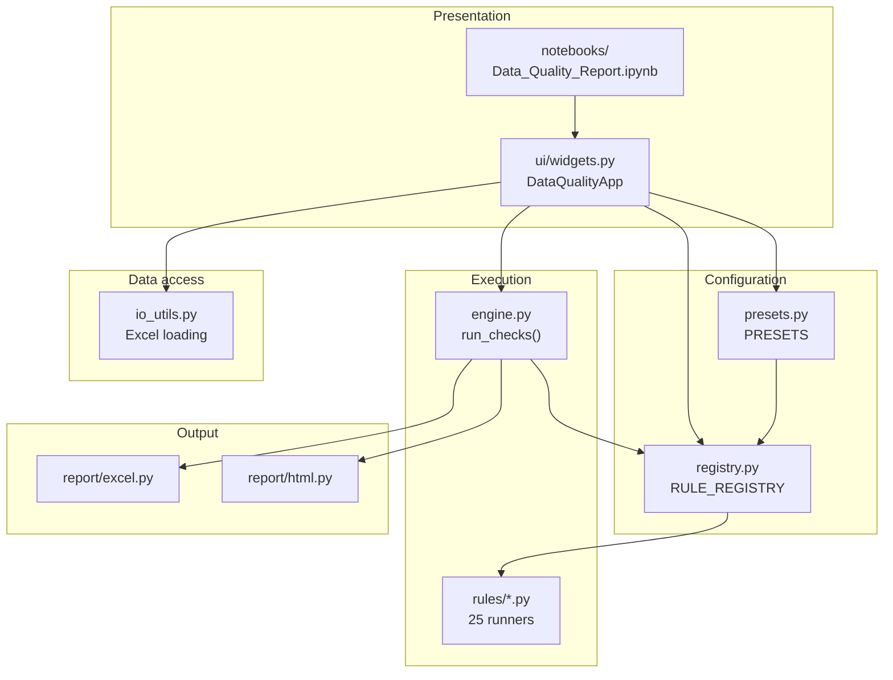
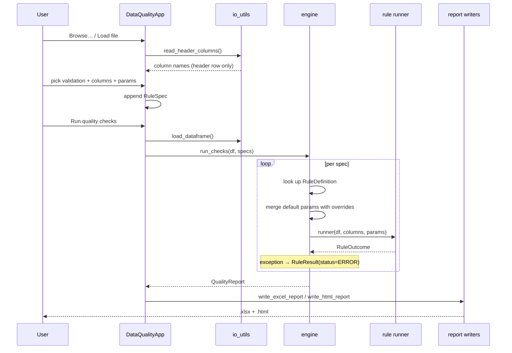

# 2. Architecture

## 2.1 The one idea

Everything is driven by a **rule registry**. The registry holds metadata about
each check — its label, dimension, how many columns it needs, what parameters it
accepts, and the function that performs it. The UI, the presets and the engine
all read from that one structure.

The consequence: **adding a rule to the registry makes it appear in the notebook
UI automatically.** There is no second place to update, no UI code to touch, no
list to keep in sync.

---

## 2.2 Layers



Dependencies point one way only: presentation → configuration → execution.
Nothing in `rules/`, `engine.py` or `report/` imports anything from `ui/`, which
is why the whole platform runs headless as a plain script.

---

## 2.3 Module map

| Module | Responsibility |
| --- | --- |
| `models.py` | The vocabulary: `RuleSpec`, `RuleResult`, `QualityReport`. No logic beyond derived properties. |
| `registry.py` | The catalog: `ParamSpec`, `RuleDefinition`, `RULE_DEFINITIONS`, `RULE_REGISTRY`, `get_rule()`. |
| `rules/base.py` | Shared helpers: `RuleOutcome`, `outcome()`, `require_columns()`, `blank_mask()`, `get_param()`, `split_list_param()`. |
| `rules/{completeness,uniqueness,validity,consistency,hygiene,distribution}.py` | The 25 runners, one function each. |
| `engine.py` | Orchestration: `run_rule()`, `run_checks()`. Error isolation lives here. |
| `presets.py` | Named bundles plus the fuzzy column matcher. |
| `io_utils.py` | Path validation, sheet listing, header-only reads, DataFrame loading, profiling. |
| `report/excel.py` | Multi-sheet workbook via XlsxWriter. |
| `report/html.py` + `templates/` | Self-contained dashboard via Jinja2 and matplotlib. |
| `ai_insights/` | Combined-report AI Insights: history log, trend statistics, and decision-tree root cause analysis (`root_cause.py`: a rule-based tree plus a scikit-learn tree learned from row-level failures). Read-only over results; no external AI service. |
| `ui/widgets.py` | ipywidgets front end. Presentation only — it builds `RuleSpec`s and calls the engine. |

---

## 2.4 The three core types

```python
RuleSpec(rule_id, columns, params, label)   # input:  what to check
RuleOutcome(failed_index, message, ...)     # rule → engine
RuleResult(status, failed_count, ...)       # output: what happened
QualityReport(results, notes, ...)          # everything from one run
```

`RuleSpec` is the contract between the UI and the engine. It is plain data —
serialisable with `to_dict()` / `from_dict()` — which is why a widget-built
configuration and a hand-written script produce identical results.

`RuleResult` derives `status` from the raw counts:

| `status` | Condition |
| --- | --- |
| `PASS` | No error, zero failed rows, `rule_failed` false |
| `FAIL` | Failed rows > 0, **or** `rule_failed` is true |
| `ERROR` | The runner raised |

`rule_failed` exists because some checks fail at the dataset level without
pointing at specific rows — "there should be at least 50 ZDEP records but there
are 12". Flagging every row would be misleading, so the flag lets a rule report
failure with an empty row set.

---

## 2.5 The rule contract

Every rule is one function with the same signature:

```python
def my_rule(df: pd.DataFrame, columns: Sequence[str], params: Dict[str, Any]) -> RuleOutcome:
    ...
```

It builds a boolean **failure** mask (`True` = this row is a problem) and hands
it to `outcome()`, which converts it to an index list:

```python
from dq_platform.rules.base import blank_mask, get_param, outcome, require_columns

def null_blank(df, columns, params):
    column = require_columns(df, columns, count=1)[0]
    mask = blank_mask(df[column])
    return outcome(mask, message=f"{int(mask.sum())} blank value(s) in '{column}'.")
```

A rule may also return:

- `detail_table` — a DataFrame surfaced as its own report sheet (used by the
  profiling rules),
- `derived` — a computed column such as `Duration_Days`,
- `rows_checked` — when the rule only evaluated a subset,
- `rule_failed` — dataset-level failure with no offending rows.

Rules raise `ValueError` for bad configuration. The engine catches it.

---

## 2.6 Execution flow



Two details worth calling out:

**Header-only reads.** `read_header_columns()` opens the workbook with openpyxl
in read-only mode and pulls just row 1. Column dropdowns therefore populate
instantly regardless of file size; the full sheet is only materialised when you
click Run.

**Error isolation.** `run_rule()` wraps each runner in `try/except`. A rule that
blows up becomes an `ERROR` row in the report; the other 20 checks still run and
you still get a report. A single malformed column never costs you the run.

---

## 2.7 How the UI stays generic

`ui/widgets.py` contains no knowledge of any specific rule. It reads
`RULE_DEFINITIONS` and renders from metadata:

| Metadata | Drives |
| --- | --- |
| `dimension` + `label` | The grouped validation dropdown |
| `description` | The help line under the dropdown |
| `arity` (`0`, `1`, `2`, `"many"`) | How many column pickers appear |
| `column_labels` | What each picker is called ("Start date column", "End date column") |
| `params[].kind` | Which widget: `text` → Text, `number` → Text with numeric parsing, `bool` → Checkbox, `choice` → Dropdown |
| `params[].default` | Pre-filled values |

Column pickers are `Combobox` widgets fed from the loaded header row, so they
are searchable and always reflect the actual sheet.

---

## 2.8 Presets

A preset is data, not code. Each entry names a rule plus **candidate column
names** for each role it needs:

```python
PresetRule(
    rule_id="uniqueness.duplicate_key",
    column_candidates=[["Sales Doc Nbr", "Sales Document", "Sales Doc Number"]],
    label="Duplicate Sales Doc Nbr",
)
```

`build_preset_specs(preset_name, columns)` resolves those candidates against the
sheet's real headers using `match_column()`, which normalises to lowercase
alphanumeric (dropping spaces, underscores and punctuation) and tries exact
matches first, then substring matches. It returns `(specs, notes)` — the
runnable checks plus a note for every entry it had to skip.

Presets are therefore **best-effort, never fatal**: a sheet missing three
columns still runs the other eight checks.

See [Creating Presets](03-creating-presets.md).

---

## 2.9 Reporting

Both writers consume a `QualityReport` and know nothing about how it was built.

**Excel** (`report/excel.py`) uses XlsxWriter for conditional formatting on the
Status column and internal hyperlinks from `Rule_Details` to each detail sheet.
Sheet names are sanitised — Excel forbids `[ ] : * ? / \` and caps names at 31
characters — with automatic de-duplication when two checks truncate to the same
name.

**HTML** (`report/html.py`) renders a Jinja2 template with `select_autoescape`
enabled. Charts are matplotlib figures on the Agg backend, base64-encoded into
`` tags, so the output is a single portable file. DataFrames go through
`to_html(escape=True)` and are wrapped in `Markup` — spreadsheet cell contents
are untrusted input and are never injected raw.

---

## 2.10 Design decisions

| Decision | Why |
| --- | --- |
| Registry-driven rather than a rule class hierarchy | A rule is one function. Inheritance would add ceremony without behaviour. |
| Rules return an index, not a filtered frame | Keeps memory flat and lets the report show the original row alongside the failure. |
| No single "quality score" | A weighted score hides which check failed. Pass/fail counts plus per-check detail are actionable. |
| Widget-first, no config files | The audience is analysts in a notebook, not a CI pipeline. The scripted API covers the automation case. |
| Presets skip rather than fail | Real sheets vary. Partial results beat no results. |
| Errors isolated per rule | One bad column should not cost you the other 20 checks. |
| `src/` layout with an editable install | Tests import the installed package, so import bugs surface locally rather than in someone else's environment. |

---

## 2.11 Repository layout

```
DataQualityModelling/
├─ docs/                          # this documentation
├─ notebooks/
│  └─ Data_Quality_Report.ipynb   # the UI entry point
├─ scripts/
│  └─ generate_sample_workbook.py # 300-row sample with planted defects
├─ src/dq_platform/
│  ├─ __init__.py                 # public API
│  ├─ models.py                   # RuleSpec, RuleResult, QualityReport
│  ├─ registry.py                 # the rule catalog
│  ├─ engine.py                   # run_rule, run_checks
│  ├─ presets.py                  # named bundles + column matcher
│  ├─ io_utils.py                 # Excel access
│  ├─ rules/                      # base.py + 6 dimension modules
│  ├─ report/                     # excel.py, html.py, templates/
│  └─ ui/widgets.py               # ipywidgets front end
├─ tests/                         # pytest suite
├─ data/                          # sample workbooks
└─ reports/                       # generated output
```

---

## 2.12 Dependencies

| Package | Used for |
| --- | --- |
| pandas | All data manipulation |
| openpyxl | Reading `.xlsx`, including header-only reads |
| XlsxWriter | Writing the formatted report workbook |
| ipywidgets | The notebook UI |
| Jinja2 | The HTML template |
| matplotlib | Charts (Agg backend, no display needed) |
| phonenumbers | Phone validation |
| pytest | Tests |
