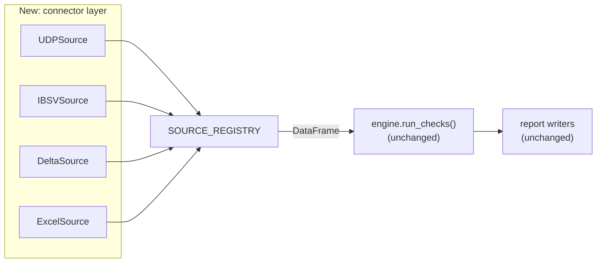

# 4. Next Steps — Databricks and Multiple Data Sources

Status: **proposed design.** Nothing here is built yet. This document is the
plan for taking the platform from a local Excel tool to a shared,
multi-source service on Databricks.

---

## 4.1 The goal

Today a user picks an Excel file. The target is a dropdown of **data sources** —
UDP, IBSV, Delta tables, and Excel — where the analyst selects a source, picks a
dataset, chooses validations, and runs. The check logic, the presets and the
reports stay exactly as they are.

```
Today                          Target
─────                          ──────
[ Browse… ] file.xlsx          Source:  [ UDP        ▾ ]
Sheet:  [ Contracts ▾ ]        Dataset: [ contracts   ▾ ]
                               (Excel stays as one of the options)
```

---

## 4.2 Why this is a small change

The architecture already separates data access from everything else.
`io_utils.py` is the only module that knows what Excel is; `engine.py`,
`registry.py`, `rules/`, `presets.py` and `report/` all operate on a DataFrame
and never learn where it came from.

So the work is: **replace one module with a pluggable interface, and follow the
same registry pattern already used for rules.**



---

## 4.3 The connector interface

Mirror `RuleDefinition`: a small dataclass describing the source plus the
callables that fetch from it.

```python
# src/dq_platform/sources/base.py
from abc import ABC, abstractmethod

class DataSource(ABC):
    """Anything the platform can read a DataFrame from."""

    source_id: str        # "udp", "ibsv", "delta", "excel"
    label: str            # "UDP" — what the dropdown shows
    description: str

    @abstractmethod
    def list_datasets(self) -> list[str]:
        """Tables, views or sheets the user can pick from."""

    @abstractmethod
    def list_columns(self, dataset: str) -> list[str]:
        """Column names only — must stay cheap. Powers the pickers."""

    @abstractmethod
    def load(self, dataset: str, limit: int | None = None) -> pd.DataFrame:
        """Materialise the data."""
```

Registered exactly like rules:

```python
# src/dq_platform/sources/registry.py
SOURCE_REGISTRY: dict[str, DataSource] = {
    s.source_id: s for s in (ExcelSource(), UDPSource(), IBSVSource(), DeltaSource())
}
```

The UI then renders a **Source** dropdown from `SOURCE_REGISTRY` and a
**Dataset** dropdown from `list_datasets()` — the same metadata-driven approach
that already builds the validation dropdown. Adding a source becomes one class
plus one registry line, with no UI changes.

`list_columns()` is deliberately separate from `load()`. It preserves today's
behaviour where pickers populate instantly: on Excel it reads row 1, on a
warehouse it is a `DESCRIBE TABLE` or a `LIMIT 0` query. Full data is only
pulled when the user clicks Run.

### Retrofitting Excel

`ExcelSource` is a thin wrapper over the existing functions, which keeps the
current behaviour intact and validates the interface against something already
working:

```python
class ExcelSource(DataSource):
    source_id, label = "excel", "Excel workbook"

    def __init__(self, path: str | None = None):
        self.path = path

    def list_datasets(self):            return list_sheets(self.path)
    def list_columns(self, dataset):    return read_header_columns(self.path, dataset)
    def load(self, dataset, limit=None):
        df = load_dataframe(self.path, dataset)
        return df.head(limit) if limit else df
```

---

## 4.4 Warehouse connectors

For UDP, IBSV and any other SQL-backed source, one parameterised connector
covers them all:

```python
class SQLSource(DataSource):
    def __init__(self, source_id, label, catalog, schema, warehouse_secret_scope):
        ...

    def list_datasets(self):
        return [r.tableName for r in
                spark.sql(f"SHOW TABLES IN {self.catalog}.{self.schema}").collect()]

    def list_columns(self, dataset):
        return spark.table(f"{self.catalog}.{self.schema}.{dataset}").columns

    def load(self, dataset, limit=None):
        sdf = spark.table(f"{self.catalog}.{self.schema}.{dataset}")
        if limit:
            sdf = sdf.limit(limit)
        return sdf.toPandas()
```

UDP and IBSV then become configuration rather than code:

```python
UDPSource  = SQLSource("udp",  "UDP",  catalog="udp_prod",  schema="contracts", ...)
IBSVSource = SQLSource("ibsv", "IBSV", catalog="ibsv_prod", schema="install_base", ...)
```

> **Open item.** The actual catalog/schema names, access paths and auth model for
> UDP and IBSV need to be confirmed with the owning teams before this can be
> implemented. If either is reachable only over JDBC or a REST API rather than
> Unity Catalog, it gets its own `DataSource` subclass — the interface is the
> same either way.

### Non-negotiables for warehouse sources

- **Never build SQL by string-concatenating user input.** Identifiers must be
  validated against the results of `list_datasets()` / `list_columns()` before
  interpolation, and values must always be bound parameters. This is the primary
  injection risk introduced by the whole feature.
- **Credentials come from Databricks secrets** (`dbutils.secrets.get`) or
  Unity Catalog service credentials. Never from a notebook cell, a config file
  or an environment variable committed to the repo.
- **Access is the caller's, not the platform's.** Run under the user's identity
  so existing table grants apply, rather than a shared service principal that
  sees everything.
- **Row limits are mandatory.** A default `LIMIT` with an explicit override,
  otherwise someone will `toPandas()` a billion-row table and kill the driver.

---

## 4.5 The pandas/Spark question

`toPandas()` is fine to start with and wrong at scale. Two options:

**Option A — sample and profile (recommended first).**
Pull a bounded sample (say 1M rows or a date-partitioned slice) into pandas and
run today's rules unchanged. Zero changes to the rule layer. Honest as long as
the report states the sample size and how it was drawn.

**Option B — native Spark rules.**
Add a second runner per rule that operates on a Spark DataFrame, selected by the
engine based on input type. The `RuleDefinition` gains an optional
`spark_runner` field; rules without one fall back to sampling.

```python
RuleDefinition(
    rule_id="completeness.null_blank",
    runner=completeness.null_blank,              # pandas
    spark_runner=completeness.null_blank_spark,  # optional
    ...
)
```

Start with A. Add B only for the rules that actually get run against
billion-row tables — most checks are cheap and most datasets are not that large.

Note that some rules cannot be expressed on a sample without qualification:
duplicate detection, distinct-value ratios and one-to-one mapping checks are
only meaningful over the full dataset. These should either be pushed down as SQL
aggregates or clearly labelled as sample-scoped in the report.

---

## 4.6 Deployment on Databricks

### Packaging

Publish `dq_platform` as a wheel and install it cluster-wide or via
Databricks Asset Bundles, rather than having each user pip-install from a repo
path:

```yaml
# databricks.yml
bundle:
  name: dq-platform

artifacts:
  dq_platform:
    type: whl
    path: .

resources:
  jobs:
    nightly_contract_qc:
      tasks:
        - task_key: run_checks
          notebook_task:
            notebook_path: notebooks/Scheduled_Run.ipynb
            base_parameters:
              source: udp
              dataset: contracts
              preset: "HPE Contract QC"
          libraries:
            - whl: ../dist/dq_platform-*.whl
```

### Two ways to run

| Mode | For | Mechanism |
| --- | --- | --- |
| **Interactive** | Analysts exploring a dataset | The existing notebook. ipywidgets render in Databricks notebooks. |
| **Scheduled** | Recurring QC on a known dataset | A parameterised job using the scripted API, driven by widget parameters. |

The scripted path already exists and needs no changes beyond swapping the
loader:

```python
source = SOURCE_REGISTRY[dbutils.widgets.get("source")]
dataset = dbutils.widgets.get("dataset")

df = source.load(dataset, limit=1_000_000)
specs, notes = build_preset_specs(dbutils.widgets.get("preset"), source.list_columns(dataset))
report = run_checks(df, specs, source_path=f"{source.label}/{dataset}", notes=notes)
```

### Where the output goes

Local file paths do not work on Databricks. Reports should be written to a
Unity Catalog volume or object storage:

```
/Volumes/<catalog>/<schema>/dq_reports/<source>/<dataset>/<yyyy-mm-dd>/
```

This needs a small change to the report writers to accept a writable stream or
a `dbfs:`/`/Volumes/` path rather than assuming a local `Path`.

### Results history

The bigger win from scheduling: persist `report.details_frame()` to a Delta
table on every run.

```python
(spark.createDataFrame(report.details_frame())
      .withColumn("run_ts", F.lit(report.generated_at))
      .withColumn("source", F.lit(source.source_id))
      .withColumn("dataset", F.lit(dataset))
      .write.mode("append")
      .saveAsTable("dq.results.check_history"))
```

That turns a point-in-time report into a **trend**: is completeness improving,
which check regressed after last week's load, which datasets are consistently
worst. A Databricks SQL dashboard over that table serves the whole team without
anyone opening a notebook.

---

## 4.7 Phasing

| Phase | Scope | Outcome |
| --- | --- | --- |
| **1** | Extract `DataSource` interface; implement `ExcelSource`; add the source registry and the UI dropdown. | No behaviour change, connector seam in place. Fully testable locally. |
| **2** | Package as a wheel; get the notebook running on Databricks; write reports to a UC volume. | Same tool, running centrally. |
| **3** | Add `SQLSource` and the first real connector (UDP or IBSV, whichever has clearer access). | Multi-source dropdown live. |
| **4** | Add the remaining connectors and dataset-specific presets. | Broad coverage. |
| **5** | Scheduled jobs + Delta results history + SQL dashboard. | Trends and alerting, not just reports. |
| **6** | Native Spark runners for the rules that need them. | Scales past sampling. |

Phase 1 is worth doing regardless of whether Databricks happens — it is a clean
refactor that makes the codebase better and is independently testable.

---

## 4.8 Open questions

Answer these before starting phase 3:

**Access**
- Are UDP and IBSV exposed through Unity Catalog, or only JDBC/REST?
- What is the auth model — user identity passthrough, or a service principal?
- Which catalogs/schemas hold the datasets that actually need QC?

**Scale**
- Typical and worst-case row counts per dataset?
- Is sampling acceptable to the consumers of these reports, and if so how must
  it be disclosed?

**Governance**
- Do any of these datasets contain PII or export-controlled data? Flagged rows
  are written verbatim into reports — that may need masking or restricted
  output locations.
- Who may run checks against production data, and where may the output land?
- What is the retention policy for generated reports and the history table?

**Operations**
- Who owns the presets once they are shared? A preset change silently alters
  everyone's results, so presets should be versioned and reviewed like code.
- Where do failures alert to when a scheduled run fails?

---

## 4.9 Smaller improvements worth considering

Independent of Databricks:

- **CSV and Parquet support** — a small `io_utils` addition, immediately useful.
- **Saved configurations** — `RuleSpec` already serialises via
  `to_dict()`/`from_dict()`; persisting a named set of checks to JSON is a
  short piece of work and covers the "run the same 15 checks monthly" case
  without needing a full preset.
- **Run comparison** — diff two `QualityReport`s to show what changed since the
  last run. Most of the value of the history table, without the infrastructure.
- **Threshold-based pass/fail** — allow a rule to be marked as tolerable below
  N% failures, so a report can produce a genuine red/amber/green rather than
  raw counts.
